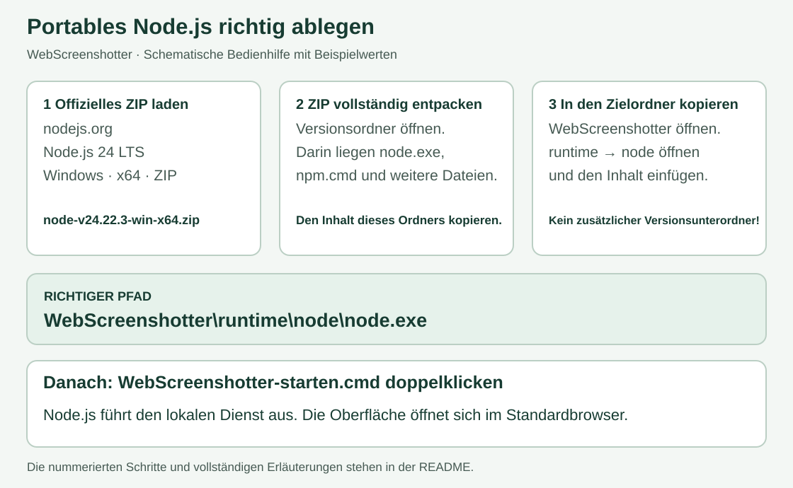
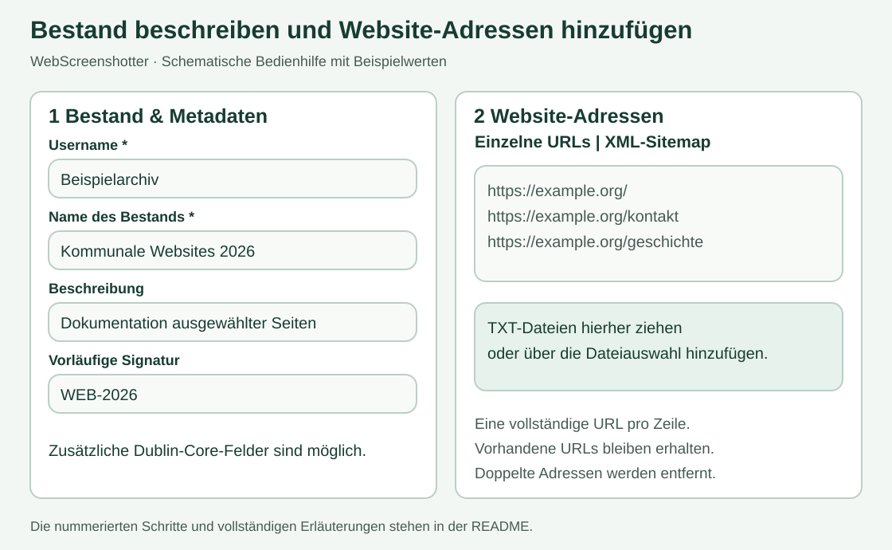
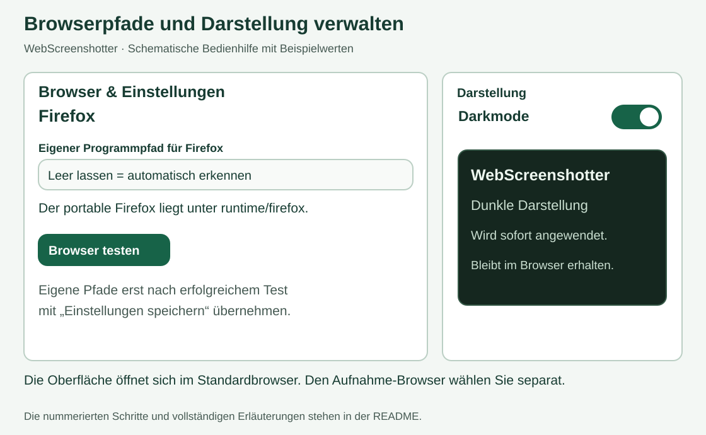
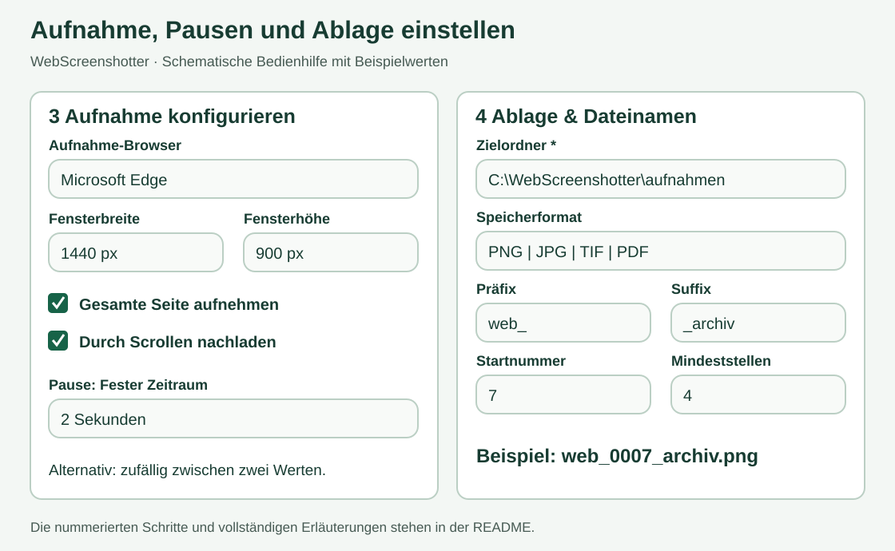
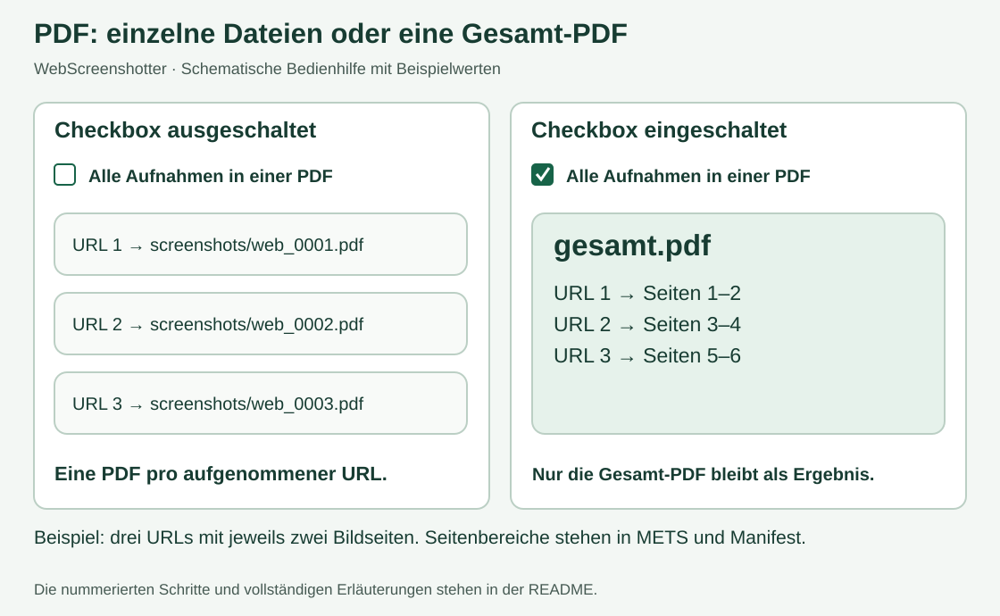
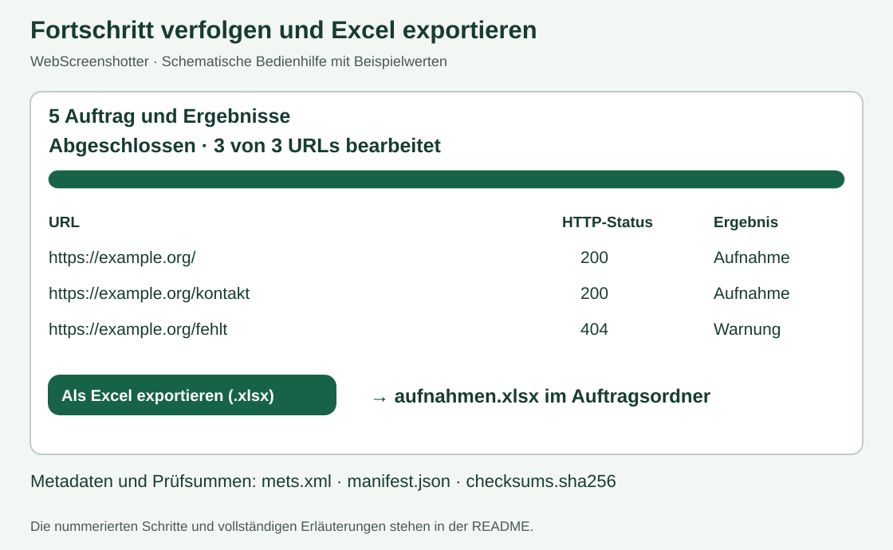

# WebScreenshotter

**Tool zum automatisierten Anfertigen von Screenshots mit Metadaten.**

WebScreenshotter nimmt Websites automatisch auf und speichert die Bilder mit nachvollziehbaren Metadaten auf Ihrem PC. Die Oberfläche läuft lokal im Windows-Standardbrowser.

**Version 1.3.1 · Dokumentationsstand: 26. November 2026 · Lizenz: Apache-2.0**

## Start hier

Für den ersten Auftrag mit dem vollständigen **Windows-Paket**:

1. Die ZIP-Datei mit Rechtsklick → **Alle extrahieren** vollständig entpacken.
2. Im entpackten Ordner **WebScreenshotter-starten.cmd doppelklicken**. Das schwarze CMD-Fenster geöffnet lassen; es betreibt die Anwendung.
3. Die Oberfläche öffnet sich im Standardbrowser. Falls sie nicht erscheint, die Adresse aus dem CMD-Fenster öffnen, normalerweise `http://127.0.0.1:4317`.
4. **Username**, **Name des Bestands** und eine vollständige Website-Adresse eintragen. Der Username ist eine Bearbeiterangabe, kein Benutzerkonto.
5. Einen verfügbaren **Aufnahme-Browser**, **PNG** und den **Zielordner** wählen. Die übrigen Werte können für den ersten Auftrag unverändert bleiben.
6. **Aufnahme starten** anklicken. Nach Abschluss liegen Bilder und Metadaten im neu angelegten Auftragsordner innerhalb des Zielordners.
7. Zum Beenden in das CMD-Fenster wechseln und **Strg+C** drücken. Das Schließen des Browser-Tabs allein beendet den Dienst nicht.

**Hilfe beim Start:** Fehlt Node.js, folgen Sie [Portables Node.js einrichten](#portables-nodejs-einrichten). Haben Sie den Quellcode aus Git statt des vollständigen Pakets, beginnen Sie bei [Start aus dem Git-Quellcode](#start-aus-dem-git-quellcode). Andere Meldungen erläutert die [Fehlerbehebung](#fehlerbehebung).

> **Ausführliche bebilderte Anleitung:** In der Oberfläche links **Ausführliche Anleitung** wählen; der Link öffnet einen neuen Tab, sodass das Aufnahmeformular erhalten bleibt. Derselbe Link steht in der **Kurzanleitung**. Ohne laufende Anwendung können Sie [ANLEITUNG.html](ANLEITUNG.html) per Doppelklick öffnen. Bilder und Gestaltung liegen im mitgelieferten Ordner `docs`; diesen zusammen mit der HTML-Datei aufbewahren.

Die Abbildungen sind schematische Bedienhilfen mit Beispielwerten, keine Screenshots eines tatsächlich ausgeführten Aufnahmeauftrags. Alle wesentlichen Informationen stehen zusätzlich im Text.

## Inhalt

- [Start hier](#start-hier)
- [Entstehung des Tools](#entstehung-des-tools)
- [Funktionsumfang](#funktionsumfang)
- [Voraussetzungen](#voraussetzungen)
- [Schnellstart](#schnellstart)
- [Portables Node.js einrichten](#portables-nodejs-einrichten)
- [Start aus dem Git-Quellcode](#start-aus-dem-git-quellcode)
- [Erster Auftrag Schritt für Schritt](#erster-auftrag-schritt-für-schritt)
- [URLs und TXT-Dateien](#urls-und-txt-dateien)
- [XML-Sitemaps](#xml-sitemaps)
- [Browser und Einstellungen](#browser-und-einstellungen)
- [Aufnahmeoptionen und Zeitabstände](#aufnahmeoptionen-und-zeitabstände)
- [Fehlgeschlagene Aufnahmen wiederholen](#fehlgeschlagene-aufnahmen-wiederholen)
- [Ablage und Dateinamen](#ablage-und-dateinamen)
- [PDF-Ausgabe](#pdf-ausgabe)
- [Fortschritt und Abbruch](#fortschritt-und-abbruch)
- [Excel-Export](#excel-export)
- [Metadaten und Dateiformat](#metadaten-und-dateiformat)
- [Darstellung und Zugänglichkeit](#darstellung-und-zugänglichkeit)
- [Aufbewahren und Übertragen](#aufbewahren-und-übertragen)
- [Fehlerbehebung](#fehlerbehebung)
- [Technische Grenzen](#technische-grenzen)
- [Lizenz](#lizenz)
- [Entwicklung und Git](#entwicklung-und-git)
- [Quellen und weiterführende Dokumentation](#quellen-und-weiterführende-dokumentation)

## Entstehung des Tools

Die ursprüngliche Grundlage war ein Python-Skript zum Anfertigen von Website-Screenshots. Dieses Skript war für den vorgesehenen Einsatz zu technisch: Einrichtung und Bedienung setzten Kenntnisse voraus, die für einen einfachen Aufnahmeauftrag nicht erforderlich sein sollten.

Deshalb wurde die Anwendung noch einmal durch KI-unterstütztes **Vibecoding** als portable Lösung mit HTML, CSS und JavaScript umgesetzt. Anforderungen und Bedienabläufe wurden in natürlicher Sprache beschrieben, der entstandene Quellcode anschließend angepasst und geprüft.

Die heutige Anwendung benötigt kein Python. **Node.js bleibt erforderlich**, weil es den lokalen JavaScript-Dienst ausführt. Dieser übernimmt Browsersteuerung, Dateiausgabe und Metadatenverarbeitung. Ein Doppelklick auf `public/index.html` startet deshalb nicht die vollständige Anwendung.

## Funktionsumfang

- Einzelne oder mehrere URLs, TXT-Import per Drag-and-drop oder Dateiauswahl sowie XML-Sitemaps.
- Headless-Aufnahmen mit Chrome/Chromium, Microsoft Edge oder Firefox.
- Einstellbare Fenstergröße, ganze Seiten oder sichtbarer Ausschnitt und automatisches Scrollen.
- Feste oder zufällige Pausen, zusätzliche Ladezeit und Zeitlimit pro Seite.
- Einstellbare Wiederholungsversuche mit eigenen festen oder zufälligen Wartezeiten und vollständiger Dokumentation jedes Versuchs.
- Ausgabe als PNG, JPG, TIF oder PDF.
- Bei PDF entweder einzelne Dateien pro URL oder ausschließlich eine gemeinsame `gesamt.pdf`.
- Zielordner und Dateinamen mit Präfix, Laufnummer, führenden Nullen und Suffix.
- Bestandsangaben und zusätzliche Dublin-Core-Felder.
- METS 2.0 mit eingebettetem Dublin Core und PREMIS 3.0.
- Dokumentation von URL, Zeitpunkt, Titel, HTTP-Status, Browser, User-Agent und SHA-256.
- Fortschrittsanzeige, Protokoll, Abbruch und Excel-Export.
- Darkmode und Unterstützung der Tastaturbedienung.

Aufgenommen wird die gerenderte Ansicht einer Website. Das Tool erstellt keine vollständige Offline-Kopie aller Website-Dateien und kein WARC-Webarchiv.

## Voraussetzungen

| Bestandteil | Voraussetzung |
| --- | --- |
| Betriebssystem für das portable Paket | Windows 10 oder 11, 64-Bit-Intel-/AMD-Prozessor, also x64. |
| Node.js | Mindestens Version 22; enthalten ist Node.js 24.22.3. Diese Anleitung verwendet die weiterhin unterstützte 24-LTS-Reihe. |
| Browser für die Oberfläche | Ein eingerichteter Windows-Standardbrowser. |
| Browser für Aufnahmen | Ein auf dem PC verfügbarer Chrome/Chromium, Edge oder Firefox. Aufnahme-Browser werden separat bereitgestellt. |
| Speicherort | Vollständig entpackter Programmordner und beschreibbarer Zielordner. |
| Netzwerk | Für die aufzunehmenden Websites; beim Einrichten eines Git-Checkouts zusätzlich für die Paketinstallation. |
| Speicherplatz / Arbeitsspeicher | Abhängig von Anzahl, Länge und Format der Aufnahmen. Lange Seiten und Gesamt-PDFs können viel Speicher benötigen. |

Eine Ausgabe für Windows ARM64 oder 32-Bit-Windows ist nicht enthalten. Für das Entpacken von portablem Node.js in einen beschreibbaren Ordner ist keine systemweite Installation nötig. Unternehmensrichtlinien können das Ausführen portabler Programme einschränken.

**Zwei Browser-Aufgaben:** Der Standardbrowser zeigt die Oberfläche. Der separat gewählte **Aufnahme-Browser** erstellt die Screenshots. Diese Auswahl ändert nicht Ihren Windows-Standardbrowser.

## Schnellstart

### Vollständiges Windows-Paket

1. `WebScreenshotter-Windows-x64.zip` herunterladen.
2. Im Explorer Rechtsklick auf die ZIP-Datei, dann **Alle extrahieren**.
3. Einen beschreibbaren Speicherort wählen und den entpackten Ordner öffnen. Nicht aus der ZIP-Vorschau starten.
4. Prüfen: `WebScreenshotter-starten.cmd`, `server.js`, `node_modules` und `runtime` liegen zusammen im Hauptordner.
5. **WebScreenshotter-starten.cmd doppelklicken.**
6. Das CMD-Fenster geöffnet lassen. Die Oberfläche öffnet sich automatisch im Standardbrowser.
7. Falls kein Browserfenster erscheint, die im CMD-Fenster angezeigte Adresse manuell öffnen. Normalerweise: `http://127.0.0.1:4317`.
8. Nach der Nutzung im CMD-Fenster **Strg+C** drücken und eine gegebenenfalls angezeigte Rückfrage bestätigen.

Es gibt genau **einen Starter**: `WebScreenshotter-starten.cmd`. Die frühere Datei `Screenshotter-starten.cmd` wurde entfernt. Alte Verknüpfungen müssen auf den neuen Namen zeigen.

Der Starter verwendet zuerst `runtime/node/node.exe`. Fehlt diese Datei, sucht er nach einer installierten Node.js-Version über den Windows-Suchpfad. Er installiert oder lädt selbst keine Programme nach.

### Bei einer Fehlermeldung

- **Node.js fehlt:** [Portables Node.js einrichten](#portables-nodejs-einrichten) befolgen.
- **JavaScript-Pakete fehlen:** Vollständiges Paket erneut entpacken oder [Start aus dem Git-Quellcode](#start-aus-dem-git-quellcode) beachten.
- **Browser nicht verfügbar:** **Browser & Einstellungen** öffnen und den Programmpfad prüfen.

## Portables Node.js einrichten

Dieser Abschnitt hilft, wenn `runtime/node/node.exe` fehlt, der Starter Node.js nicht findet oder Sie den Quellcode aus Git verwenden.

**Node.js ist die Laufzeitumgebung für JavaScript außerhalb des Browsers.** „Portabel“ bedeutet: Die Windows-ZIP-Ausgabe wird in den WebScreenshotter-Ordner entpackt. Ein Installationsassistent und eine dauerhafte Änderung der Windows-Umgebungsvariablen sind dafür nicht nötig.



### 1. Den offiziellen Download öffnen

Öffnen Sie die [offizielle Node.js-Downloadseite](https://nodejs.org/en/download/). Für diese Anleitung eignet sich **Node.js 24 LTS**, wie im fertigen WebScreenshotter-Paket.

Direkt zu den offiziellen Dateien dieser Reihe:

**[Node.js 24: ZIP-Dateien und Prüfsummen](https://nodejs.org/dist/latest-v24.x/)**

Wählen Sie dort die Datei mit der Endung **`-win-x64.zip`**. Zum Dokumentationsstand heißt sie `node-v24.22.3-win-x64.zip`. Die Versionsnummer kann sich später ändern.

| Datei / Auswahl | Bedeutung |
| --- | --- |
| `node-v24.…-win-x64.zip` | Richtige portable Ausgabe für diese Windows-x64-Anleitung. |
| `.msi` | Systemweiter Installationsassistent; für die portable Ablage nicht erforderlich. |
| `win-arm64` | Andere Prozessorarchitektur; nicht die x64-Ausgabe. |
| `.tar.gz`, `.tar.xz`, `.pkg` | Andere Paketarten bzw. Betriebssysteme. |

Node.js ausschließlich von der offiziellen Website beziehen. Im selben Downloadverzeichnis enthält `SHASUMS256.txt` die veröffentlichten SHA-256-Prüfsummen.

### 2. Die Node.js-ZIP entpacken

1. Die heruntergeladene Datei `node-v24.…-win-x64.zip` im Explorer suchen.
2. Rechtsklick, dann **Alle extrahieren**.
3. Den entpackten Ordner öffnen.
4. Gegebenenfalls den darin liegenden Versionsordner `node-v24.…-win-x64` öffnen.
5. Dort müssen unter anderem **`node.exe`**, `npm.cmd`, `LICENSE` und `node_modules` sichtbar sein.

`node.exe` nicht per Doppelklick starten. Diese Datei wird später vom WebScreenshotter-Starter aufgerufen.

### 3. Den richtigen Zielordner anlegen

1. Den WebScreenshotter-Hauptordner öffnen: den Ordner mit `WebScreenshotter-starten.cmd` und `server.js`.
2. Darin einen Ordner namens `runtime` anlegen, falls er fehlt.
3. `runtime` öffnen.
4. Darin den Ordner `node` anlegen, falls er fehlt, und öffnen.

**Der vom Starter erwartete Ordner heißt `runtime` ohne abschließendes „s“.** `runtimes/` wird ebenfalls von Git ignoriert, ist aber kein alternativer Suchpfad des Starters.

### 4. Den entpackten Inhalt kopieren

1. Zum entpackten Node.js-Ordner zurückgehen, in dem `node.exe` liegt.
2. Mit **Strg+A** den gesamten Inhalt auswählen.
3. Mit **Strg+C** kopieren.
4. In den WebScreenshotter-Unterordner `runtime/node` wechseln.
5. Mit **Strg+V** einfügen.

Kopieren Sie den **Inhalt** des Versionsordners. Zwischen `node` und `node.exe` darf keine zusätzliche Ordnerebene liegen.

| Pfad relativ zum WebScreenshotter-Hauptordner | Bewertung |
| --- | --- |
| `runtime/node/node.exe` | Richtig. Diesen Pfad verwendet der Starter. |
| `runtime/node/node-v24.22.3-win-x64/node.exe` | Ein Versionsordner zu viel. Dessen Inhalt nach oben kopieren. |
| `runtimes/node/node.exe` | Falscher Ordnername für den Starter. `runtime` verwenden. |
| `node.exe` direkt neben dem Starter | Nach `runtime/node` verschieben. |

Die Node.js-eigenen Dateien unter `runtime/node/node_modules` gehören zu Node.js bzw. npm. Sie ersetzen **nicht** die Projektabhängigkeiten in `node_modules` direkt neben `server.js`.

### 5. Prüfen und starten

Doppelklicken Sie erneut auf **WebScreenshotter-starten.cmd**.

Für eine genaue Versionsprüfung im Explorer den WebScreenshotter-Hauptordner öffnen, in die Adressleiste `powershell` eingeben und Enter drücken. Dann:

```powershell
.\runtime\node\node.exe --version
```

Eine Ausgabe wie `v24.22.3` bestätigt, dass die portable Datei ausführbar ist. Die Hauptversionsnummer muss mindestens 22 sein. Anschließend:

```powershell
.\WebScreenshotter-starten.cmd
```

Im vollständigen Windows-Paket sind die Projektpakete schon enthalten. Erscheint bei einem Git-Checkout jetzt **„JavaScript-Pakete fehlen“**, mit dem nächsten Abschnitt fortfahren.

### Node.js aktualisieren

WebScreenshotter zuerst mit Strg+C beenden. Eine passende, unterstützte Node.js-Version herunterladen, entpacken und die Inhalte von `runtime/node` ersetzen.

Für die normale Nutzung prüft der Starter die Mindestversion. Wer ein neues verteilbares Windows-Paket baut, muss auch `runtime/versions.json` mit den passenden Versions- und Prüfsummenangaben pflegen; siehe [Entwicklung und Git](#entwicklung-und-git).

## Start aus dem Git-Quellcode

Ein Git-Checkout enthält den Quellcode. Wegen der `.gitignore` fehlen insbesondere `runtime/`, `runtimes/` und die Projektabhängigkeiten in `node_modules/`.

1. Repository klonen oder Quellcode herunterladen und entpacken.
2. Portables Node.js wie oben einrichten, einschließlich `npm.cmd` und der übrigen ZIP-Inhalte.
3. Im Explorer den Hauptordner mit `package.json` öffnen.
4. In die Adressleiste `powershell` eingeben und Enter drücken.
5. Folgende Befehle nacheinander ausführen:

```powershell
$env:PATH = "$PWD\runtime\node;$env:PATH"
.\runtime\node\npm.cmd ci
.\WebScreenshotter-starten.cmd
```

Die erste Zeile ergänzt Node.js nur für dieses PowerShell-Fenster im Suchpfad. `npm ci` installiert die in `package-lock.json` festgelegten JavaScript-Pakete. Dafür wird Internet benötigt. `npm.cmd` vermeidet die Verwechslung mit einem möglicherweise durch PowerShell-Richtlinien blockierten `npm.ps1`.

Ist Node.js bereits systemweit installiert, können Sie stattdessen `node --version` prüfen und im Projektordner `npm.cmd ci` ausführen.

Ein Aufnahme-Browser muss ebenfalls auf dem PC verfügbar sein. Chrome, Edge und Firefox werden an üblichen Installationsorten gesucht. Bei Bedarf unter **Browser & Einstellungen** einen eigenen Programmpfad hinterlegen und mit **Browser testen** prüfen.

## Erster Auftrag Schritt für Schritt



1. **Neue Aufnahme** auswählen.
2. **Username** eintragen, etwa `Beispielarchiv`. Das ist eine Bearbeiterangabe für die Metadaten, kein Login.
3. **Name des Bestands** eintragen, etwa `Website-Test`.
4. Optional **Beschreibung** und **Vorläufige Signatur** ergänzen.
5. Unter **Einzelne URLs** eine vollständige Adresse eingeben, etwa `https://example.org/`.
6. Einen verfügbaren **Aufnahme-Browser** wählen.
7. Für den ersten Test 1440 Pixel Breite, 900 Pixel Höhe und die übrigen Standardwerte belassen.
8. Einen beschreibbaren **Zielordner** wählen; der vorausgefüllte Ordner kann verwendet werden.
9. **PNG**, Präfix `web_`, Startnummer 1 und vier Stellen wählen.
10. **Aufnahme starten** anklicken.
11. Den Fortschritt unten verfolgen und nach Abschluss die Bilder und `mets.xml` im Auftragsordner prüfen.

Felder mit Sternchen sind Pflichtfelder. Username, Bestandsname, gültige Adressen, ein verfügbarer Aufnahme-Browser und ein gültiger Zielordner sind erforderlich.

### Zusätzliche Metadaten

Über die Schaltfläche zum Hinzufügen weiterer Metadatenfelder lassen sich Dublin-Core-Elemente auswählen und Werte eintragen. Elemente dürfen mehrfach vorkommen. Leere Zusatzfelder werden nicht exportiert.

| Element | Bedeutung / Beispiel |
| --- | --- |
| `title` | Zusätzlicher Titel oder alternative Bezeichnung. |
| `creator` | Urheber oder weitere verantwortliche Person. |
| `subject` | Thema, Schlagwort oder Klassifikation. |
| `description` | Ergänzende Inhaltsbeschreibung. |
| `publisher` | Herausgebende Stelle. |
| `contributor` | Weitere beteiligte Personen oder Stellen. |
| `date` | Fachlich relevante Datumsangabe des Bestands. |
| `type` | Art des Inhalts. |
| `format` | Ergänzende Formatangabe. |
| `identifier` | Weitere Kennung oder Signatur. |
| `source` | Herkunft oder Quelle. |
| `language` | Sprache, etwa `de`. |
| `relation` | Zugehöriger Bestand oder verknüpfte Ressource. |
| `coverage` | Räumlicher oder zeitlicher Bezug. |
| `rights` | Rechte- oder Nutzungsangabe. |

Diese Zusatzfelder beschreiben den Bestand. Technische Angaben zur einzelnen Aufnahme werden automatisch ergänzt. Höchstens 100 zusätzliche Metadatenfelder sind möglich.

## URLs und TXT-Dateien

### Adressen direkt eingeben

Eine vollständige HTTP- oder HTTPS-Adresse pro Zeile:

```text
https://example.org/
https://example.org/kontakt
https://example.org/geschichte
```

Leere Zeilen sind erlaubt. Gleiche, nach der Normalisierung übereinstimmende Adressen werden zusammengefasst; die Reihenfolge des ersten Auftretens bleibt erhalten. Andere Protokolle wie `file:` sind nicht vorgesehen.

### TXT-Dateien importieren

1. Eine Textdatei mit einer URL pro Zeile anlegen und als `.txt` speichern, vorzugsweise UTF-8.
2. Die Datei auf den URL-Bereich ziehen und loslassen.
3. Alternativ die Dateiauswahl unter **TXT-Dateien hierher ziehen oder auswählen** verwenden.
4. Die Importmeldung prüfen.

Beispiel:

```text
# Erster Testbestand
https://example.org/
https://example.org/kontakt

# Weitere Seiten
https://example.org/geschichte
```

Beim TXT-Import sind mit `#` beginnende Kommentarzeilen erlaubt. Vorhandene URLs bleiben vor den neuen Adressen stehen; Duplikate werden übersprungen.

Mehrere TXT-Dateien dürfen zusammen höchstens **2 MiB** groß sein. Ein Auftrag darf höchstens **10.000 eindeutige URLs** enthalten. Unterstützt werden UTF-8 sowie UTF-16 mit BOM und Windows-/Unix-Zeilenenden.

Bei einer ungültigen Zeile wird der gesamte Import zurückgewiesen. Die bisherige Eingabe bleibt erhalten. Die Meldung benennt die betreffende Datei bzw. Zeile.

## XML-Sitemaps

1. **XML-Sitemap** auswählen.
2. Die vollständige Sitemap-Adresse eintragen, etwa `https://example.org/sitemap.xml`.
3. **Sitemap prüfen** anklicken und das Ergebnis abwarten.
4. Den Auftrag wie gewohnt starten.

Unterstützt werden Sitemaps, Sitemap-Indizes, verschachtelte Sitemaps, XML-Namensräume und `.xml.gz`. Bildverweise aus Sitemap-Erweiterungen werden nicht als Seiten-URLs behandelt.

Die Sitemap wird beim Start erneut eingelesen und kann sich seit der Vorschau geändert haben. Grenzen: 100 Sitemap-Dateien, acht Verschachtelungsebenen, jeweils 10 MiB und 10.000 eindeutige Seiten-URLs.

## Browser und Einstellungen



### Erkennung und eigene Programmpfade

Unter **Browser & Einstellungen** zeigt die Anwendung erkannte Browser an. Übliche Installationsorte und unter Windows zusätzlich die App-Paths-Registrierung werden geprüft.

Ein eigenes Pfadfeld kann leer bleiben; dann gilt die Erkennung. Bei Bedarf den vollständigen Pfad zur ausführbaren Datei eintragen, beispielsweise:

```text
C:\Program Files\Google\Chrome\Application\chrome.exe
C:\Program Files (x86)\Microsoft\Edge\Application\msedge.exe
C:\Program Files\Mozilla Firefox\firefox.exe
```

Die tatsächlichen Installationsorte können abweichen. Ein eigener Pfad überschreibt die Erkennung. Ein ungültiger Pfad wird gemeldet; es erfolgt kein stillschweigender Browserwechsel.

**Browser testen** prüft mit den aktuellen Eingaben Browserstart, Testseite und Testaufnahme. Anschließend **Einstellungen speichern** verwenden. Ein erfolgreicher Test zeigt Browserversion, Testbildgröße und User-Agent.

### Unterstützte Browser

| Browser | Einsatz |
| --- | --- |
| Chrome / Chromium | Headless-Aufnahmen über Playwright/CDP mit dem installierten Programm. |
| Microsoft Edge | Headless-Aufnahmen über Playwright/CDP mit dem installierten Programm. |
| Firefox | Ansteuerung über WebDriver BiDi; Kompatibilität mit **Browser testen** prüfen. |
| Safari | Pfad kann erkannt oder hinterlegt werden. Wegen fehlenden unterstützten Headless-Betriebs nicht als Aufnahme-Browser auswählbar. |

Der Aufnahme-Browser arbeitet im Hintergrund. Die Bedienoberfläche öffnet sich im Windows-Standardbrowser. Eine ausdrücklich gewählte oder gespeicherte Browserauswahl bleibt erhalten.

Aufnahmen verwenden isolierte Profile. Persönliche Cookies, Anmeldungen und Erweiterungen des normalen Browsers werden nicht übernommen. Login-Seiten und Cookie-Banner können daher im Bild erscheinen.

## Aufnahmeoptionen und Zeitabstände



| Einstellung | Wirkung / Standard |
| --- | --- |
| Fensterbreite | Standard 1440 CSS-Pixel, erlaubt 320–7680. Beeinflusst das responsive Website-Layout. |
| Fensterhöhe | Standard 900 CSS-Pixel, erlaubt 240–4320. |
| Gesamte Seite aufnehmen | Aktiv: auch Inhalte unterhalb des sichtbaren Bereichs. Inaktiv: eingestellter Ausschnitt. |
| Inhalte durch automatisches Scrollen nachladen | Versucht, beim Scrollen nachgeladene Inhalte vor der Aufnahme sichtbar zu machen. |
| Fester Zeitraum | Gleiche Pause vor der nächsten URL, nachdem alle Versuche der vorherigen URL beendet sind; Standard 2 Sekunden. |
| Zufälliger Zeitraum | Neue Pause zwischen Minimum und Maximum; Standard 2–5 Sekunden. |
| Warten nach Seitenaufbau | Zusätzliche Zeit vor der Aufnahme; Standard 2 Sekunden, erlaubt 0–120. |
| Zeitlimit je Seitenaufruf | Standard 45 Sekunden, erlaubt 5–300. |

Die Pause zwischen Aufnahmen beginnt **nach Abschluss der vorherigen Aufnahme**. Sie ist von der zusätzlichen Wartezeit nach dem Laden einer Seite getrennt. Feste und zufällige Pausen dürfen 0–86.400 Sekunden betragen.

### Fehlgeschlagene Aufnahmen wiederholen

Unter **Aufnahme konfigurieren → Weitere Aufnahmeoptionen** stehen die **Wiederholungsversuche (Retries)**.

1. Die Zahl der zusätzlichen Versuche einstellen: **0** deaktiviert Wiederholungen und ist die Voreinstellung. **2** erlaubt den ersten Versuch und höchstens zwei Wiederholungen, insgesamt also drei Versuche pro URL.
2. Bei einer Anzahl größer als 0 unter **Wartezeit zwischen Wiederholungen** entweder **Fester Zeitraum** oder **Zufälliger Zeitraum** wählen.
3. Eine feste Wartezeit in Sekunden oder die Werte **Mindestens** und **Höchstens** eingeben. Für jede Wiederholung wird ein neuer Zufallswert innerhalb dieser Grenzen gewählt.
4. Den Auftrag starten. Der Status zeigt den aktuellen Versuch und bei einer Wiederholung den Countdown an.

Erlaubt sind 0–20 zusätzliche Versuche und Wartezeiten von 0–86.400 Sekunden. Die feste Retry-Wartezeit beträgt zunächst 5 Sekunden; für die zufällige Wartezeit sind 2–10 Sekunden voreingestellt. Diese Zeiten sind unabhängig von der Pause zwischen unterschiedlichen URLs.

| Eingestellte Retries | Höchstens mögliche Versuche pro URL |
| --- | --- |
| 0 | 1 erster Versuch, keine Wiederholung. |
| 1 | 1 erster Versuch + 1 Wiederholung = 2 Versuche. |
| 2 | 1 erster Versuch + 2 Wiederholungen = 3 Versuche. |
| 20 | 1 erster Versuch + 20 Wiederholungen = 21 Versuche. |

Die Wartezeiten haben unterschiedliche Aufgaben:

| Einstellung | Wann sie gilt |
| --- | --- |
| Pause zwischen Seitenaufrufen | Vor der nächsten **anderen URL**, sobald die vorherige URL einschließlich aller Wiederholungen abgeschlossen ist. Vor der ersten URL gibt es diese Pause nicht. |
| Wartezeit zwischen Wiederholungen | Zwischen einem Fehlversuch und dem nächsten Versuch **derselben URL**. Die normale Seitenpause wird hier nicht zusätzlich addiert. Ein Zufallswert wird für jede Wiederholung neu gewählt. |
| Wartezeit nach Seitenaufbau | Zusätzliche Ladezeit vor dem Screenshot, etwa für dynamische Inhalte. Sie ersetzt keine der beiden Pausen. |
| Zeitlimit pro Seitenaufruf | Grenze für einzelne Browseraktionen, damit ein nicht reagierender Browser nicht unbegrenzt blockiert. Es ist kein Gesamtzeitlimit für den Auftrag oder alle Retries zusammen. |

Wiederholt werden fehlgeschlagene Aufnahmen, Netzwerkfehler und Antworten des aufgerufenen Hauptdokuments mit HTTP-Status 4xx/5xx. Ein erfolgreicher Versuch beendet die Wiederholungen sofort. Hinweise wie das Erreichen des Scroll-Limits lösen allein keine Wiederholung aus. Benutzerabbruch und ein abgestürzter Aufnahme-Browser beenden den Ablauf; ein abgestürzter Browser wird nicht automatisch neu gestartet.

Zwischengeschaltete HTTP-Fehlerseiten erzeugen keine zusätzlichen Bilddateien. Ist auch der letzte Versuch eine HTTP-Fehlerseite, wird sie nach Möglichkeit als Aufnahme mit Warnung erhalten. Bei 0 Retries bleibt damit das bisherige Verhalten erhalten. Reine Aufnahme- oder Netzwerkfehler ohne gespeichertes Bild bleiben als fehlgeschlagenes Ergebnis dokumentiert.

**Jeder Versuch wird protokolliert**, auch wenn eine spätere Wiederholung erfolgreich ist: mit URL, Versuchsnummer, Zeitpunkten, Ergebnis, Fehlertext und letztem verfügbarem HTTP-Status. Gibt es keine Serverantwort, lautet der Status im Manifest und JSON-Protokoll ausdrücklich `null`; die Oberfläche meldet den fehlenden Status. Es wird kein HTTP-Code erfunden. Beispielsweise kann ein Screenshotfehler nach einer erfolgreichen Serverantwort trotzdem HTTP 200 besitzen.

`protokoll.jsonl` enthält je Versuch einen Datensatz vom Typ `capture-attempt`, das Manifest bewahrt die Historie in `records[].attempts`, und METS enthält pro Versuch ein eigenes PREMIS-Ereignis. Fehlversuche werden bereits vor der Retry-Wartezeit gesichert. Dateinamen, Laufnummern, Gesamt-PDF und Excel behalten einen Ergebniseintrag pro URL; Excel zeigt den abschließenden Versuch bzw. die erhaltene Datei.

**Beispiel:** Bei zwei eingestellten Retries antwortet eine URL zuerst mit HTTP 503 und beim zweiten Versuch mit HTTP 200. Nach dem ersten Fehler wartet die Anwendung die eingestellte Retry-Zeit ab. Nach dem erfolgreichen zweiten Versuch endet die Wiederholung. Es entstehen eine Bilddatei, ein abschließendes URL-Ergebnis und eine Excel-Zeile; beide Versuche einschließlich HTTP 503 bleiben in Protokoll, Manifest und PREMIS erhalten. Erst vor der nächsten URL gilt wieder die normale Seitenpause.

Die Ergebnistabelle zeigt den letzten Versuch und die Anzahl dokumentierter Versuche. Für die vollständige Historie nach Abschluss **protokoll.jsonl**, **manifest.json** oder **mets.xml** öffnen. Ein Abbruch während der Retry-Pause erhält die bisherigen Versuche, ohne einen weiteren Abruf zu erfinden. Die Historie ermöglicht die Nachprüfung; nach einem Neustart wird ein Auftrag nicht automatisch fortgesetzt.

## Ablage und Dateinamen

Der **Zielordner** ist der übergeordnete Speicherort. Jeder Auftrag erhält einen neuen Unterordner mit Bestandsname, Zeitstempel und eindeutiger Kennung. Vorhandene Aufnahmen werden nicht überschrieben.

Über die Ordnerschaltfläche einen vorhandenen Ordner auswählen oder einen absoluten Pfad eingeben, etwa `C:\WebScreenshotter\aufnahmen`. Dieser Pfad muss auf dem PC gelten, auf dem der Dienst läuft.

**Dateiname = Präfix + Laufnummer mit Mindeststellenzahl + Suffix + Endung**

| Einstellung | Beispiel |
| --- | --- |
| Präfix | `web_` |
| Startnummer | `7` |
| Mindeststellenzahl | `4` |
| Suffix | `_archiv` |
| Format | PNG |
| Ergebnis | `web_0007_archiv.png`, `web_0008_archiv.png`, … |

Führende Nullen füllen die Mindeststellenzahl auf. Größere Zahlen werden nicht abgeschnitten. Die Nummerierung folgt den URLs in Eingabereihenfolge. Alle Versuche derselben URL behalten dieselbe Laufnummer; nach einem endgültigen Fehler kann eine Nummer ohne Bilddatei auftreten.

Startnummer: 0–999.999.999. Mindeststellen: 1–12. Präfix und Suffix dürfen keine Pfadtrenner oder ungültigen Windows-Dateinamenzeichen enthalten.

### Ausgabeformate

| Format | Eigenschaften |
| --- | --- |
| PNG | Verlustfrei. |
| JPG | Komprimiertes Bild; Qualität 1–100, Standard 92. |
| TIF | Unkomprimiertes RGBA-TIFF, häufig größere Dateien. |
| PDF | Bildbasierte Ausgabe; lange Screenshots können mehrere Seiten belegen. |

## PDF-Ausgabe



Bei **Speicherformat → PDF** erscheint **Alle Aufnahmen in einer PDF**.

| Checkbox | Ergebnis |
| --- | --- |
| Ausgeschaltet | Eine PDF pro URL unter `screenshots/` mit dem gewählten Benennungsschema. |
| Eingeschaltet | Ausschließlich `gesamt.pdf` im Auftragsordner, in URL-Reihenfolge. |

Eine lange Website kann mehrere PDF-Seiten belegen. Ergebnistabelle, Manifest und METS dokumentieren die Seitenbereiche der Gesamt-PDF ab Seite 1.

Während der Aufnahme liegen PDF-Teile in `pdf-zwischenstand/`. Erst nach Speicherung der Gesamt-PDF und ihrer Metadaten werden diese entfernt. Bei einem Abbruch werden fertige Teile nach Möglichkeit noch zusammengeführt; ein erneuter Abbruch während dieses Schritts beendet auch die Zusammenführung.

Scheitert die Zusammenführung, bleiben die Teile zur Rettung erhalten. Eine unvollständige Gesamt-PDF wird nicht als fertiges Ergebnis veröffentlicht. Ohne erfolgreiche Aufnahme entsteht keine leere Gesamt-PDF.

Die PDFs enthalten Bilder, keinen durchsuchbaren Website-Text. Sie sind weder PDF/A noch getaggte PDF/UA-Dokumente. Die Zusammenführung ist auf 256 MiB Quell-PDFs und 5.000 Seiten begrenzt.

## Fortschritt und Abbruch



Unten erscheinen Status, aktuelle URL, Fortschritt, Wartepausen, Meldungen und Ergebnislinks.

- HTTP 200 bedeutet normalerweise eine erfolgreiche Auslieferung.
- Bei HTTP 4xx/5xx wird die dargestellte Antwortseite nach Möglichkeit aufgenommen und als Warnung dokumentiert.
- Ein Netzwerk- oder Aufnahmefehler wird dokumentiert; aktivierte Wiederholungen werden vor dem Wechsel zur nächsten URL durchgeführt.
- Ein erkannter Browserabsturz beendet den Auftrag und speichert den vorhandenen Zwischenstand.

**Auftrag abbrechen** stoppt den Auftrag. Bereits gespeicherte Bilder bleiben erhalten. Den Dienst während des abschließenden Schreibens der Metadaten bzw. der PDF-Zusammenführung weiterlaufen lassen.

Es läuft ein Auftrag zur Zeit. Nach dessen Ende kann ein neuer gestartet werden.

**Ein Neustart setzt einen unterbrochenen Auftrag nicht automatisch fort.** Das Manifest enthält den erreichten Stand und noch offene URLs. Fertige Dateien bleiben erhalten. Frühere Aufträge werden nach einem Neustart nicht automatisch in die Oberfläche geladen.

## Excel-Export

Nach Abschluss, Abbruch oder einem bereits dokumentierten fehlgeschlagenen Auftrag **Als Excel exportieren (.xlsx)** anklicken. `aufnahmen.xlsx` wird im Auftragsordner gespeichert und zum Download angeboten. Dafür ist keine Excel-Installation nötig.

| Spalte | Inhalt |
| --- | --- |
| ID | Laufnummer entsprechend der Startnummer. |
| Dateiname (ohne Endung) | Name der erhaltenen Aufnahme ohne Dateiendung. |
| Titel der URL | Beim Abruf erfasster Seitentitel. |
| Abgerufene Adresse | Endgültige HTTP(S)-Adresse nach Weiterleitungen; ersatzweise Antwortadresse oder ursprünglich angefragte URL. |
| Datum / Uhrzeit | Aufnahmezeitpunkt, ersatzweise Antwortzeitpunkt oder Beginn des Versuchs; lokale Zeitzone des PCs beim Export. |
| Statuscode | HTTP-Status, soweit vorhanden. |
| Sha256 des Screenshots | SHA-256 der erhaltenen Ausgabedatei. |
| Dateipfad | Vollständiger lokaler Pfad der erhaltenen Ausgabedatei. |

Die Datei hat genau diese acht Spalten, eine fixierte Kopfzeile und Filter. IDs, Statuscodes und Zeitpunkte sind sortierbare Zahlen-/Datumswerte. Titel und URLs werden als Text gespeichert. Fehlende Dateiangaben bleiben leer.

Im Gesamt-PDF-Modus bleibt eine Zeile pro URL. Dateiname, Hash und Pfad zeigen auf `gesamt.pdf`; Seitenbereiche stehen in Ergebnistabelle, METS und Manifest.

Excel verwendet alle abschließenden URL-Ergebnisse des Auftrags, auch wenn die Oberfläche nur die letzten 500 Ergebnisse zeigt. Jede bearbeitete URL erhält genau eine Zeile, auch bei einem endgültigen Fehler. Statuscode und übrige Angaben beziehen sich auf den letzten Versuch; frühere Versuche stehen in Protokoll, Manifest und PREMIS, nicht in zusätzlichen Excel-Zeilen. Noch nicht bearbeitete URLs stehen im Manifest unter `remainingUrls`.

Exportieren Sie während der laufenden Dienstsitzung. Nach einem Neustart können frühere Aufträge nicht erneut über die Oberfläche exportiert werden.

## Metadaten und Dateiformat

### Dateien eines Auftrags

| Datei / Ordner | Inhalt |
| --- | --- |
| `screenshots/` | Einzelaufnahmen im gewählten Format. |
| `gesamt.pdf` | Im Gesamt-PDF-Modus die einzige endgültige PDF. |
| `pdf-zwischenstand/` | Temporäre PDF-Teile, im Fehlerfall zur Rettung erhalten. |
| `mets.xml` | METS 2.0 mit Dublin Core, PREMIS und Dateiverknüpfungen. |
| `manifest.json` | Konfiguration, Browserdaten, Ergebnisse, Sitemap-Herkunft und offene URLs. |
| `checksums.sha256` | SHA-256-Prüfsummen der erhaltenen Ausgabedateien. |
| `protokoll.jsonl` | Aktivitätsprotokoll; ein JSON-Datensatz pro Zeile. |
| `aufnahmen.xlsx` | Optional erzeugte Excel-Übersicht. |

### Dublin Core

Der Bestand enthält unter anderem seinen Namen als `dc:title`, Username als `dc:creator`, Beschreibung als `dc:description` und vorläufige Signatur als `dc:identifier`. Zusätzliche Dublin-Core-Felder kommen hinzu.

Für einzelne Aufnahmen werden unter anderem Seitentitel, Quell-URL, Zeitpunkt, Medientyp und Bestandsbezug abgeleitet.

### PREMIS 3.0

PREMIS dokumentiert Versuche und Dateien: angefragte und endgültige URL, UTC-Zeitpunkte, Titel, HTTP-Status, ausgewählte Antwortheader, Aufnahmeparameter, Browserversion, User-Agent, Größe, SHA-256 und Fehlerangaben.

Bei Wiederholungen bleiben alle Versuche als getrennte Ereignisse mit eigener Kennung und Versuchsnummer erhalten. Die Datei und ihr METS-Struktureintrag verweisen auch auf die früheren Fehlversuche. Nur tatsächlich gespeicherte Bilder erhalten ein Dateiobjekt.

Ein fehlgeschlagener Versuch erhält ein Ereignis, aber keine erfundene Bilddatei. Bei der Gesamt-PDF wird die Ableitung aus Einzelteilen dokumentiert. Historische PREMIS-Angaben zu diesen Teilen bedeuten nicht, dass sie nach erfolgreicher Zusammenführung noch vorhanden sind.

### METS 2.0

Der Namensraum lautet `http://www.loc.gov/METS/v2`. Die Datei referenziert das offizielle METS-2-Schema und enthält eingebettetes Dublin Core und PREMIS, Dateiverknüpfungen und Aufnahmereihenfolge. Bei Gesamt-PDFs kommen Seitenbereiche hinzu.

METS-Dateiverweise sind relativ zum Auftragsordner. Bewahren Sie deshalb den **gesamten Auftragsordner** zusammen auf.

### Zeit und Prüfsummen

METS/PREMIS und Manifest verwenden UTC-Zeitstempel. Excel zeigt sie mit der lokalen Zeitzone des exportierenden PCs. Die zugrunde liegende Aufnahmezeit bleibt gleich.

SHA-256 kann Dateiveränderungen erkennbar machen; es ist keine digitale Signatur und kein qualifizierter Zeitstempel. Beispiel zur Prüfung einer Datei:

```powershell
Get-FileHash -Algorithm SHA256 -LiteralPath "C:\Pfad\zum\Auftrag\screenshots\web_0001.png"
```

Den Pfad ersetzen und das Ergebnis mit `checksums.sha256` vergleichen. Im Gesamt-PDF-Modus entsprechend `gesamt.pdf` prüfen.

## Darstellung und Zugänglichkeit

Unter **Browser & Einstellungen → Darstellung → Darkmode** kann die dunkle Darstellung umgeschaltet werden. Die Auswahl gilt sofort und bleibt in diesem Browser gespeichert.

Die Oberfläche bietet sichtbaren Tastaturfokus, beschriftete Felder und Dialoge, einen Sprunglink, Statusmeldungen für Screenreader und eine an schmale Fenster angepasste Darstellung. Reduzierte Bewegung und Windows-Kontrastdesigns werden berücksichtigt.

| Taste | Bedienung |
| --- | --- |
| Tab / Umschalt+Tab | Nächstes / vorheriges Bedienelement. |
| Enter | Fokussierte Aktion ausführen. |
| Leertaste | Checkbox oder Schalter bedienen. |
| Pfeiltasten | Auswahlgruppen / Auswahllisten bedienen. |
| Escape | Dialog schließen. |

Der Prüfstand ist keine vollständige WCAG-Zertifizierung. Umfassende Screenreader-Praxistests stehen noch aus. Bildbasierte PDFs werden durch eine zugängliche Bedienoberfläche nicht automatisch zu barrierefreien PDFs.

## Aufbewahren und Übertragen

### Einstellungen

Browserpfade stehen standardmäßig in `data/settings.json`. Formularentwürfe und Darkmode liegen im lokalen Speicher des Oberflächen-Browsers. Beim Browser- oder Portwechsel können diese Browserdaten fehlen.

Der Einstellungsordner ist über `WEBSCREENSHOTTER_DATA_DIR` änderbar; auch der bisherige Name `SCREENSHOTTER_DATA_DIR` wird unterstützt.

### Anwendung auf einen anderen PC kopieren

1. WebScreenshotter beenden.
2. Den gesamten entpackten Programmordner auf den anderen Windows-x64-PC kopieren.
3. Eigene absolute Browserpfade und Zielordner prüfen.
4. `WebScreenshotter-starten.cmd` doppelklicken.

Node.js wird relativ zum Projektordner gefunden. Auch ein beschreibbares USB-Laufwerk ist möglich. Auf dem Ziel-PC muss zusätzlich ein geeigneter Aufnahme-Browser verfügbar sein; eigene absolute Browserpfade dort erneut prüfen.

### Aufnahmen übertragen

Den vollständigen Auftragsordner mit Bildern, METS, Manifest und Prüfsummen kopieren. Relative METS-Verweise bleiben dadurch nutzbar. Absolute Pfade in einer bereits erzeugten Excel-Datei beschreiben weiterhin den ursprünglichen Speicherort.

Die Metadaten enthalten Bearbeiter- und Bestandsangaben, URLs und technische Aufnahmedaten. Diese Angaben gehören zum übergebenen Bestand.

## Fehlerbehebung

| Meldung / Beobachtung | Vorgehen |
| --- | --- |
| Node.js nicht gefunden | `runtime/node/node.exe` prüfen; [Portables Node.js einrichten](#portables-nodejs-einrichten) befolgen. Der Starter verweist ebenfalls auf die README. |
| Node.js zu alt oder nicht startbar | `.\runtime\node\node.exe --version` prüfen. Passendes Windows-x64-ZIP ab Version 22 verwenden; lokale Ausführungsrichtlinien beachten. |
| JavaScript-Pakete fehlen | Vollständiges Paket erneut entpacken oder im Quellcode-Ordner `npm.cmd ci` ausführen. |
| Browserfenster öffnet sich nicht | Angezeigte lokale Adresse manuell im Standardbrowser öffnen. |
| Port bereits belegt | Laufende Instanz verwenden oder beenden; alternativ anderen Port setzen. |
| „Aufnahme starten“ deaktiviert | Verbindung, Pflichtfelder und verfügbaren ausgewählten Aufnahme-Browser prüfen. |
| Kein Aufnahme-Browser | **Browser & Einstellungen**, Programmpfad und **Browser testen** prüfen. |
| Browser-Test hängt / Browser stürzt ab | Dienst in einem normalen lokalen Terminal starten; Browserinstallation und lokale Richtlinien prüfen. Unterprozesse müssen erlaubt sein. |
| TXT-Import fehlgeschlagen | Gemeldete Zeile, HTTP(S)-Adresse und Kodierung prüfen. Bisherige Eingabe bleibt erhalten. |
| Website-Inhalte fehlen | Wartezeit erhöhen und Scrollen prüfen. Login, Cookie-Banner und unendliches Nachladen werden nicht automatisch aufgelöst. |
| Gesamt-PDF fehlt | Protokoll und Manifest lesen; erhaltene PDF-Teile sichern und Größen-/Seitenlimits beachten. |
| Excel nach Neustart nicht verfügbar | Export vor Ende der Dienstsitzung erzeugen. Bereits gespeicherte Dateien liegen weiter im Auftragsordner. |
| Neue Beschriftungen nicht sichtbar | Dienst neu starten und Browserseite neu laden. |
| Alte Verknüpfung funktioniert nicht | Auf `WebScreenshotter-starten.cmd` umstellen. |

### Anderen Port verwenden

Im Projektordner PowerShell öffnen:

```powershell
$env:PORT = "4318"
.\WebScreenshotter-starten.cmd
```

Die angezeigte Adresse verwenden, beispielsweise `http://127.0.0.1:4318`.

### Ohne automatisches Browserfenster

```powershell
.\WebScreenshotter-starten.cmd --no-open
```

Oder direkt:

```powershell
.\runtime\node\node.exe server.js
```

Der Dienst bindet nur an die lokale Loopback-Adresse. Er ist nicht als öffentlich erreichbarer Webserver vorgesehen.

## Technische Grenzen

| Bereich | Grenze / Eigenschaft |
| --- | --- |
| URLs | 10.000 eindeutige URLs pro Auftrag. |
| TXT-Import | Zusammen 2 MiB pro Import. |
| Zusatzmetadaten | 100 Felder. |
| Wiederholungsversuche | 0–20 zusätzliche Versuche pro URL; 0 = ausgeschaltet. |
| Sitemaps | 100 Dateien, acht Ebenen, jeweils 10 MiB. |
| Einzelbilder | 80 Megapixel und 60.000 Pixel Höhe. |
| Automatisches Scrollen | Höchstens 50 Schritte bzw. etwa 15 Sekunden. |
| Gesamt-PDF | 256 MiB Quell-PDFs und 5.000 Seiten. |
| Ergebnisvorschau | Letzte 500 Datensätze; Excel verwendet den gesamten Auftrag. |
| Excel-Zellen | 32.767 Zeichen. Längere Texte werden nur in Excel gekürzt, Originaldaten bleiben im Manifest. |
| Neustart | Keine automatische Wiederaufnahme oder Anzeige früherer Aufträge. |
| Website-Interaktion | Keine automatische Anmeldung oder allgemeine Cookie-Banner-Bedienung. |

Ergebnisse können je nach Website, Browser und lokalen Rechten variieren. In der eingeschränkten Entwicklungsumgebung konnten erfolgreiche echte Aufnahmen zuletzt nicht für alle Browser bestätigt werden. Prüfungen und Grenzen stehen im [PRUEFBERICHT.md](PRUEFBERICHT.md).

## Lizenz

WebScreenshotter einschließlich der eigenen Dokumentation steht unter der **Apache License, Version 2.0** (`Apache-2.0`). Der vollständige Lizenztext liegt in [LICENSE](LICENSE); die Kennung steht außerdem in `package.json` und `package-lock.json`. Die Lizenzdatei wird mit dem Windows-Paket weitergegeben.

Mitgelieferte Laufzeiten, Bibliotheken und externe Prüfschemas behalten ihre jeweiligen Lizenzen und Hinweise. Die Projektlizenz ersetzt diese nicht. Einzelheiten stehen in [THIRD_PARTY.md](THIRD_PARTY.md) und bei den [Prüfschemas](test/schemas/README.md). Maßgeblich ist der [offizielle Apache-2.0-Lizenztext](https://www.apache.org/licenses/LICENSE-2.0.txt).

## Entwicklung und Git

### Projektstruktur

| Pfad | Aufgabe |
| --- | --- |
| `server.js` | Lokaler Dienst, API, Sitzungsschutz und Downloads. |
| `public/` | HTML, CSS und Browser-JavaScript. |
| `src/` | Browsersteuerung, Aufträge, Bildformate, Metadaten und Excel. |
| `test/` | Funktionstests, Integrationstests und offizielle Prüfschemas. |
| `scripts/check.js` | JavaScript-Syntaxprüfung. |
| `scripts/build-docs.js` | SVG-Bedienhilfen und `ANLEITUNG.html` aus der README erzeugen. |
| `scripts/build-portable.js` | Windows-Paket aus geprüften lokalen Laufzeiten und Abhängigkeiten bauen. |
| `docs/images/` | Schematische Abbildungen der Anleitung. |
| `runtime/node/` | Portable Node.js-Laufzeit. |
| `LICENSE` | Apache-2.0-Lizenztext für WebScreenshotter. |
| `node_modules/` | Projektabhängigkeiten. |
| `data/` | Lokale Einstellungen. |
| `dist/` | Windows-Paket und ZIP. |

Die Anwendung bleibt JavaScript, HTML und CSS ohne Frontend-Build-Schritt. Datenverträge und Zuständigkeiten erläutert [WARTUNG.md](WARTUNG.md).

### Prüfungen

```powershell
.\runtime\node\node.exe scripts/check.js
.\runtime\node\node.exe --test test/*.test.js
.\runtime\node\node.exe --test test/integration/*.test.js
```

Integrationstests starten echte Browser und benötigen eine geeignete Umgebung. Unter Windows werden METS 2.0 und PREMIS 3.0 zusätzlich über Windows PowerShell mit einem .NET-XSD-Validator geprüft. Dies ist eine Entwicklungsprüfung; die Anwendung selbst ist ein Node.js-Dienst.

### Dokumentation neu erstellen

Nach einer README-Änderung:

```powershell
.\runtime\node\node.exe scripts/build-docs.js
```

Das erzeugt die sechs SVG-Abbildungen ohne zusätzliche Grafikbibliothek und die HTML-Anleitung mit relativen Bildpfaden.

### Windows-Paket neu erstellen

```powershell
.\runtime\node\node.exe scripts/build-portable.js
```

Benötigt werden Node.js unter `runtime/node`, dessen Lizenzdatei, `runtime/versions.json` mit Version, Herkunft und `node.executableSha256` sowie die gesperrten Projektabhängigkeiten. Das Skript prüft `node.exe` anhand der hinterlegten SHA-256-Prüfsumme und lädt nichts nach. Es kopiert ausschließlich die benötigte Node.js-Laufzeit und schreibt einen entsprechend begrenzten Herkunftsnachweis ins Paket.

Ein frischer Git-Checkout genügt für den Paketbau noch nicht: Die ausgeschlossene Node.js-Laufzeit muss ergänzt werden. Lokale Browserprogramme und persönliche Konfigurationen werden nicht eingepackt. Quellen und Lizenzen: [THIRD_PARTY.md](THIRD_PARTY.md).

### Git und Weitergabe

Die `.gitignore` schließt lokale Laufzeiten unter `runtime/` und `runtimes/` aus. Ebenfalls ausgeschlossen: persönliche `*.local.json`-Dateien, `node_modules/`, `data/`, `aufnahmen/`, `.test-output/`, `dist/` und Logdateien.

Quellcode, README, HTML-Anleitung, Abbildungen und Paketdefinitionen werden versioniert. Das vollständige portable ZIP wird separat als Download bereitgestellt.

Ignore-Regeln betreffen noch nicht versionierte Dateien. Falls Laufzeiten schon eingecheckt wurden, müssen sie zusätzlich aus dem Git-Index entfernt werden.

Für ein neues, leeres Online-Repository im Projektordner; Name, E-Mail und URL ersetzen:

```powershell
git init -b main
git config user.name "Dein Name"
git config user.email "deine-mail@example.de"
git add .
git status
git commit -m "WebScreenshotter mit Dokumentation"
git remote add origin "DEINE-CLONE-URL"
git push -u origin main
```

Vor dem Commit die Dateiliste prüfen. Ein befülltes Online-Repository muss mit seinem vorhandenen Verlauf eingebunden werden.

## Quellen und weiterführende Dokumentation

- [Offizielle Node.js-Downloads](https://nodejs.org/en/download/)
- [Node.js 24: ZIP-Dateien und Prüfsummen](https://nodejs.org/dist/latest-v24.x/)
- [Node.js: Unterstützungsstatus](https://nodejs.org/en/about/previous-releases)
- [METS 2.0 – Library of Congress](https://www.loc.gov/standards/mets/mets2.html)
- [METS-2-Schema](https://www.loc.gov/standards/mets/mets2.xsd)
- [METS 2 Guide](https://mets.github.io/METS-guide/)
- [PREMIS 3.0](https://www.loc.gov/standards/premis/v3/)
- [Dublin Core Metadata Element Set 1.1](https://www.dublincore.org/specifications/dublin-core/dces/)
- [Git: Repository anlegen](https://git-scm.com/docs/git-init)
- [Git: Ignore-Regeln](https://git-scm.com/docs/gitignore)
- [Git: Änderungen übertragen](https://git-scm.com/docs/git-push)
- [Prüfbericht](PRUEFBERICHT.md)
- [Wartungsanleitung](WARTUNG.md)
- [Lizenzen und Quellen der Drittanbieter-Komponenten](THIRD_PARTY.md)

Die Lizenzhinweise der mitgelieferten Laufzeiten und Pakete gehören zum Paket und sollten bei einer Weitergabe erhalten bleiben.
